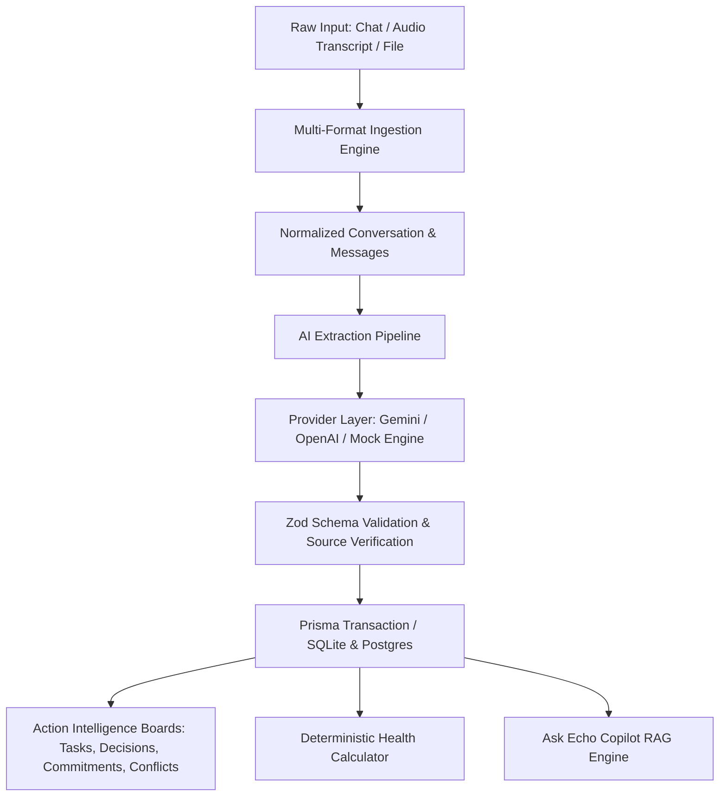

# Architecture & System Design — Echo

## System Overview

**Echo** transforms noisy, fragmented communication streams (Slack, WhatsApp, Discord, Telegram, Zoom/Teams transcripts, email threads) into verified, structured intelligence with complete bidirectional source traceability.

## Architectural Highlights

### 1. Ingestion & Normalization (`src/lib/parsing/index.ts`)
- Auto-detects message syntax across multiple platforms without manual user selection.
- Normalizes disparate timestamp and sender formats into a standard sequence with zero-indexed `orderIndex`.
- Fallback chunking preserves unstructured line breaks while maintaining chronological order.

### 2. Multi-Tier AI Provider System (`src/lib/ai/provider.ts`)
- Provider Factory gracefully negotiates available configurations:
  1. **Google Gemini** (`gemini-2.5-flash` or configurable model)
  2. **OpenAI** (`gpt-4o-mini` or configurable model)
  3. **Local Heuristic Provider**: A deterministic, rule-based extractor parsing dates, imperative assignments, decisions, personal commitments, and contradiction signals without requiring network connectivity or external API tokens.

### 3. Strict Verification & Source Traceability (`src/lib/ai/pipeline.ts`)
- All extracted items require an explicit `sourceMessageOrderIndex` pointing back to a verified raw message.
- The pipeline checks and clamps indices against valid message boundaries to eliminate dangling references or hallucinations.
- The UI features instant scroll-to-message with glowing CSS highlight animations (`highlight-flash`).

### 4. Deterministic Project Health (`src/lib/health/calculator.ts`)
- Avoids arbitrary subjective AI scoring.
- Computed algorithmically based on objective signals:
  - Overdue tasks (-15 pts)
  - Blocked tasks (-10 pts)
  - Unresolved conflicts / contradictions (-12 pts)
  - Unresolved open questions (-5 pts)
  - Unassigned tasks (-4 pts)
- Displays full factor transparency directly in the user interface.
